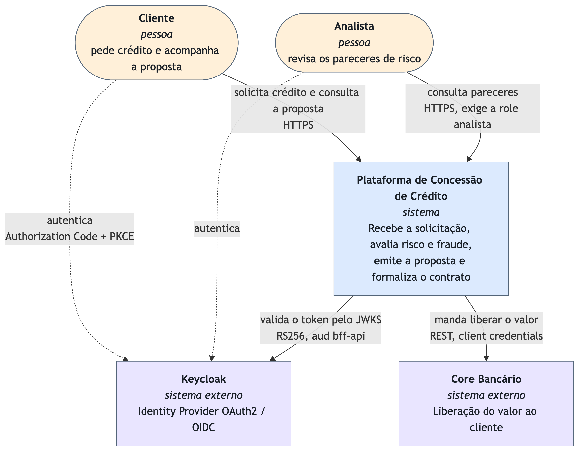
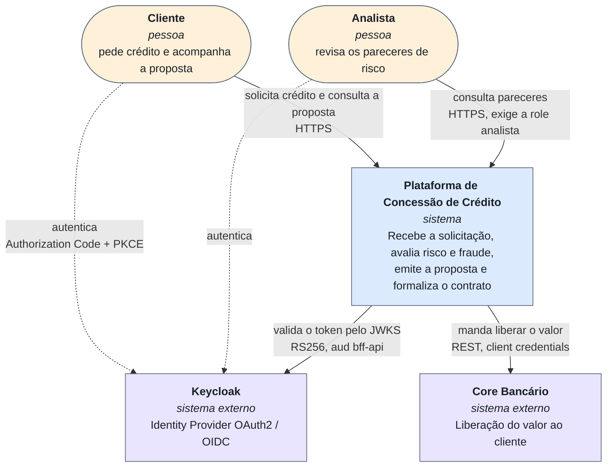

# C4 — Nível 1: Contexto

**Responsável:** Paulo Aranha · **Trilha:** `trilha/bff` · Checklist **B7**

## Escopo

Quem usa a plataforma e com que sistemas de fora ela fala. Nada de tecnologia interna: neste
nível o sistema é uma caixa só.

## Quem aparece, e por quê

- **Cliente** — pede crédito e acompanha a proposta pelo navegador. Autentica no Keycloak por
  Authorization Code + PKCE; a aplicação nunca vê a senha.
- **Analista** — revisa pareceres de risco. É a mesma porta de entrada, com a role `analista`;
  é essa diferença que a demo mostra como **403**.
- **Keycloak** — Identity Provider OAuth2/OIDC. Externo porque não é código nosso e porque
  troca-lo não muda o domínio. Decisão em [ADR-009](../adr/ADR-009-keycloak-oauth2-oidc-pkce.md).
- **Core Bancário** — quem efetivamente libera o dinheiro. No trabalho é um mock, chamado por
  client credentials a partir do `servico-contratacao`.

## O que **não** aparece, de propósito

Antifraude e análise de risco são **contextos internos**, não sistemas de terceiros: estão dentro
da caixa e aparecem no nível 2. Não há bureau de crédito externo no que foi construído — o score
de fraude é calculado pelo nosso próprio serviço.

## Fonte

`n1-contexto.drawio` é o editável (diagrams.net). O PNG sai do Mermaid abaixo:

