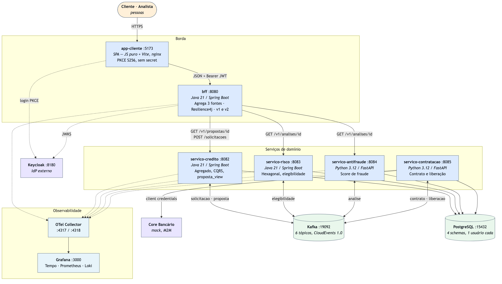
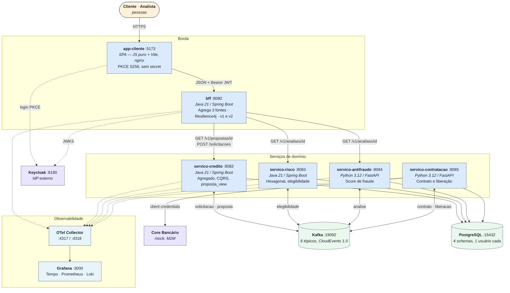

# C4 — Nível 2: Containers

**Responsável:** Paulo Aranha · **Trilha:** `trilha/bff` · Checklist **B8**

## Escopo

As unidades que sobem separadas — cada uma é um container no `docker-compose.yml` e um
Deployment em `infra/k8s/` —, com runtime, porta e por que existem.

## Os dois eixos que o desenho mostra

**Comunicação.** Síncrono só na borda: `app-cliente → bff → serviços`. Entre serviços de
domínio não há uma seta sequer de HTTP — só Kafka. É assim que o *distributed monolith* fica
fora: nenhum serviço de domínio conhece o endereço de outro.

**Dados.** Um PostgreSQL, quatro schemas, um usuário por schema com `GRANT` restrito. Nenhuma
seta de serviço para schema alheio, e um `SELECT` cruzando fronteira falha com
`permission denied`. Decisão em [ADR-002](../adr/ADR-002-fronteiras-de-contexto-e-database-per-service.md).

## Por que o BFF não é repasse

Ele agrega **três** fontes num `GET /v2/propostas/{id}`, degrada em vez de falhar quando risco
ou antifraude não respondem, e mantém `/v1` e `/v2` vivas ao mesmo tempo. As três coisas estão
na [ADR-008](../adr/ADR-008-bff-agregacao-resiliencia-versionamento.md).

## Observabilidade

Os cinco serviços exportam OTLP para o Collector, que distribui para Tempo, Prometheus e Loki,
lidos no Grafana. O `traceparent` viaja no envelope CloudEvents, então o trace atravessa o
Kafka. Decisão em [ADR-010](../adr/ADR-010-opentelemetry-e-loki.md).

## Fonte

`n2-container.drawio` é o editável (diagrams.net). O PNG sai do Mermaid abaixo:

