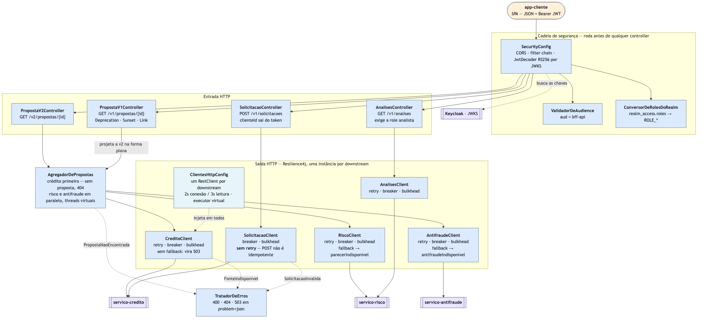
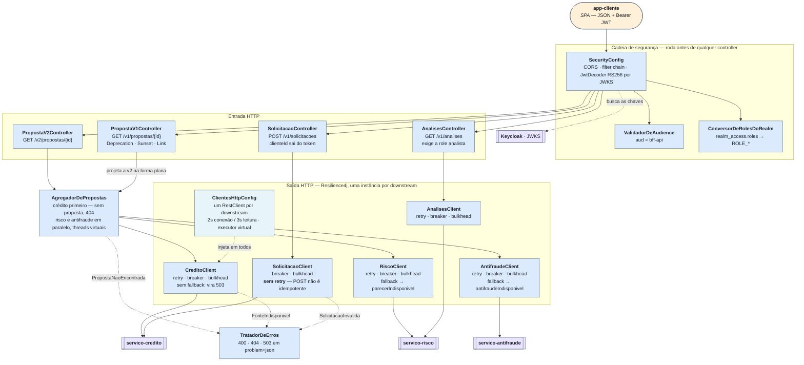

# C4 — Nível 3: Componentes do BFF

**Responsável:** Paulo Aranha · **Trilha:** `trilha/bff` · Checklist **B9**

## Escopo

O interior do `bff`: o que roda antes do controller, quem orquestra, quem fala com fora e o que
cada peça faz quando a de fora não responde.

## O que o desenho defende

**A segurança não é um componente entre outros — ela é a porta.** A cadeia do `SecurityConfig`
roda antes de qualquer controller existir no caminho. Token ausente ou inválido nunca chega na
entrada HTTP: vira 401 no filtro. Token válido sem a role vira 403 na regra da rota. É por isso
que os dois códigos saem de lugares diferentes do diagrama.

**O agregador é o único que sabe compor.** Os controllers não chamam downstream: o
`AgregadorDePropostas` chama o crédito primeiro — sem proposta, 404 sem gastar as outras duas
chamadas — e dispara risco e antifraude em paralelo, em threads virtuais. O
`PropostaV1Controller` não tem caminho próprio: ele projeta o mesmo objeto da v2 na forma plana.
Uma agregação, duas versões.

**Cada client carrega a própria política de falha, e elas não são iguais.** É a parte do desenho
que mais diz sobre a arquitetura:

| Client | Política | Por quê |
|---|---|---|
| `CreditoClient` | retry · breaker · bulkhead, **sem fallback** | sem proposta não há resposta parcial possível; vira 503 |
| `RiscoClient` | retry · breaker · bulkhead, fallback | degrada para `parecerIndisponivel` e o bloco some |
| `AntifraudeClient` | retry · breaker · bulkhead, fallback | degrada para `antifraudeIndisponivel` |
| `AnalisesClient` | retry · breaker · bulkhead | leitura do risco para a rota de analista |
| `SolicitacaoClient` | breaker · bulkhead, **sem retry** | criar solicitação não é idempotente: repetir geraria duplicata |

O `SolicitacaoClient` é o único sem retry, e isso é deliberado — há teste que falha se alguém
acrescentar a anotação. Decisões e custos na [ADR-008](../adr/ADR-008-bff-agregacao-resiliencia-versionamento.md).

**Os erros saem por um lugar só.** `PropostaNaoEncontrada`, `FonteIndisponivel` e
`SolicitacaoInvalida` sobem até o `TratadorDeErros`, que devolve `application/problem+json`. Os
dois primeiros também decidem o que **não** é falha: 404 e 400 do downstream ficam fora do
circuit breaker, porque recusa é resposta, não indisponibilidade.

## Fonte

`n3-componente-bff.drawio` é o editável (diagrams.net). O PNG sai do Mermaid abaixo:

