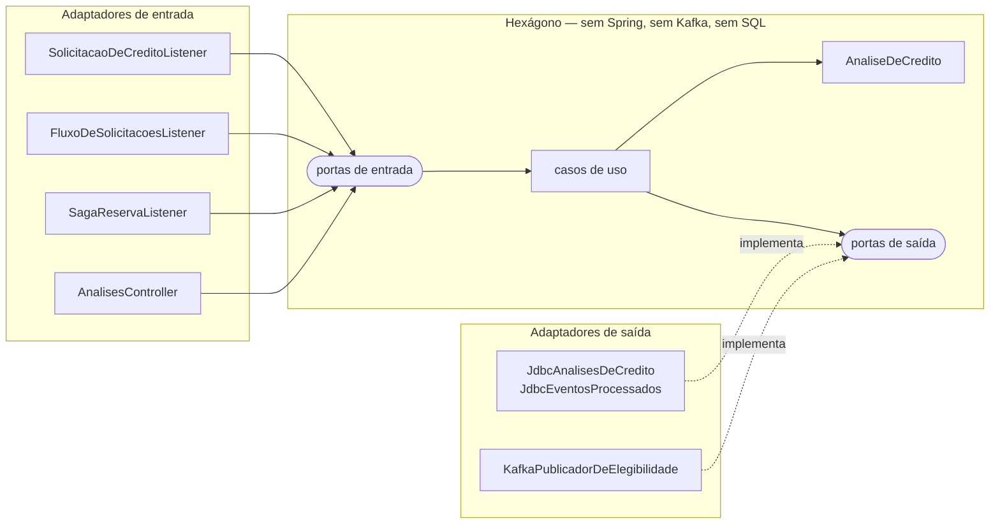

# Serviço de Risco — Java 21 / Spring Boot

**Dono: Guilherme** · `trilha/risco` · porta 8083 (8080 dentro do compose) · schema `risco`

Herdado da disciplina de Arquitetura Reativa e Event-Driven e refatorado para **Hexagonal**
(ports & adapters). Recebe cada solicitação de crédito por evento, aplica a regra de
elegibilidade no agregado `AnaliseDeCredito` e publica o parecer para Crédito e Antifraude.
Por que Hexagonal aqui e Clean no crédito — e por que é a mesma regra — na
[ADR-004](../docs/adr/ADR-004-clean-architecture-e-hexagonal.md).

## O hexágono



Toda seta aponta para dentro. Quem garante não é a disciplina de quem escreve: é o
`RegraDeDependenciaTest` (ArchUnit), que quebra o build se o domínio importar Spring ou se um
caso de uso chamar o adaptador JDBC direto.

```
src/main/java/br/pucminas/aed/risco/
├── domain/            AnaliseDeCredito, Solicitacao, Parecer, SituacaoDaReserva — só JDK
├── application/
│   ├── port/in/       AvaliarSolicitacao, AcompanharReserva, ConsultarAnalises, AgregarFluxoDeSolicitacoes
│   ├── port/out/      AnalisesDeCredito, EventosProcessados, PublicadorDeElegibilidade
│   └── *Service       os casos de uso: domínio + portas, nenhuma anotação de framework
└── adapter/
    ├── in/kafka/      os 3 listeners, a política de falha, a DLQ e o reprocessamento
    ├── in/web/        GET /v1/analises
    ├── out/jdbc/      schema risco, usuário risco_user
    ├── out/kafka/     risco.elegibilidade.v1 em CloudEvents
    └── config/        monta o hexágono e aplica a transação por fora do caso de uso
```

## A regra de elegibilidade

Concessão automática, decidida só pelo valor pedido — o único dado de crédito que chega no evento.
Mora no agregado, aplicada uma vez, na criação.

| Valor solicitado | Parecer | Valor aprovado |
|---|---|---|
| abaixo de R$ 1.000,00 | recusado | 0,00 |
| de R$ 1.000,00 a R$ 100.000,00 | elegível | o pedido |
| acima de R$ 100.000,00 até R$ 200.000,00 | elegível, **parcial** | R$ 100.000,00 |
| acima de R$ 200.000,00 | recusado | 0,00 |

O antifraude pontua o valor **aprovado** (acima de R$ 50.000,00 reprova), então os dois serviços
têm decisões alcançáveis na demo: R$ 18.500 passa nos dois, R$ 75.000 passa no risco e cai no
antifraude, R$ 300.000 para no risco.

## Eventos

| | Tópico | Grupo | Para quê |
|---|---|---|---|
| consome | `credito.solicitacao.v1` · `credito.solicitacao.solicitada.v1` | `risco-credito-v1` | avalia e publica o parecer |
| consome | os mesmos | `risco-fluxo-creditos-v1` | volume solicitado por janela de 5 min, no log |
| consome | `credito.limite.reservado.v1` · `credito.reserva-limite.cancelada.v1` | `risco-saga-reserva-v1` | situação da reserva de limite, herdada da AED |
| produz | `risco.elegibilidade.v1` | — | consumido pelo crédito (`proposta_view`) e pelo antifraude |

`credito.solicitacao.v1` é o tópico do [contrato](../docs/contratos/asyncapi.yaml). O nome
herdado continua assinado porque o `servico-credito` ainda publica nele; os dois convivem durante
a migração, e quem publicar nos dois gera um parecer só (dedup por `ce_id` e uma análise por
solicitação). Sai da propriedade `app.kafka.topico.solicitacao` quando o crédito migrar.

O parecer sai em CloudEvents 1.0, binary mode: `ce_specversion`, `ce_id`, `ce_source=/risco/analises`,
`ce_type=risco.elegibilidade.v1`, `ce_time` e `ce_datacontenttype`; chave `solicitacaoId`.
O `eventoId` (= `ce_id`) **deriva da solicitação**: reavaliar a mesma solicitação, numa reentrega
ou no reprocessamento da DLQ, gera o mesmo id, e o crédito e o antifraude descartam a cópia.
`ContratoDeSaidaTest` e `ContratoDeEntradaTest` leem o `asyncapi.yaml` e quebram se o código e o
documento divergirem.

## REST

| Rota | O quê |
|---|---|
| `GET /v1/analises?limite=50` | pareceres, os mais recentes primeiro (1 a 200) |
| `GET /v1/analises/{solicitacaoId}` | um parecer; **404** se não existe ou se o id não é UUID |
| `GET /actuator/health/readiness` · `/actuator/prometheus` | probes e métricas |
| `GET /v3/api-docs` · `/swagger-ui.html` | OpenAPI gerado; o revisado é o [`openapi-risco.yaml`](../docs/contratos/openapi-risco.yaml) |

Interno à rede dos serviços: quem expõe é o BFF, que exige a role `analista` em `GET /v1/analises`
— a rota da demo de **401/403** — e busca aqui o parecer de `GET /v2/propostas/{id}`. Id fora do
formato responde 404, e não 400, para que uma rajada de ids errados não abra o circuit breaker do
BFF. A resposta não traz o `clienteId`: nenhum consumidor precisa dele.

## Idempotência e falhas

Herdados da AED e revalidados depois do refactor (`IdempotenciaTest`, `RetentativaDlqTest`,
`ReprocessamentoDlqTest`, `SagaReservaTest`).

- **Dedup pelo `ce_id`** em `evento_processado`, na mesma transação da gravação da análise.
- **Uma análise por solicitação**: a chave primária é a `solicitacao_id`.
- **Transação por fora do caso de uso.** `CasosDeUsoConfig` embrulha a porta num
  `TransactionInterceptor`; o caso de uso não importa Spring. A publicação é síncrona e fica
  dentro da transação: broker sem confirmar desfaz a análise e o dedup, e a retentativa avalia
  de novo. Confirmação que falha depois da publicação republica o mesmo `eventoId`.
- **Retentativa** bloqueante na partição, para manter a ordem por `solicitacaoId`: 4
  retentativas, espera exponencial de 0,5 s a 5 s.
- **Falha permanente vai direto para a DLQ**, sem gastar tentativa: JSON inválido, `ce_id`
  ausente, campo fora do formato, solicitação que o domínio recusa (`SolicitacaoInvalidaException`).
- **DLQ** `<tópico>.dlq` com os bytes que chegaram, os `ce_*` originais, os `kafka_dlt-*` e o
  cabeçalho `classificacao` (`PERMANENTE` ou `TRANSITORIA`).

### Reprocessamento da DLQ

Manual, depois de corrigir a causa. Republica no tópico original só os registros `TRANSITORIA`,
com a mesma chave e os mesmos `ce_*`; o dedup cuida do resto. O que falhar de novo volta para a
DLQ e fica para a próxima execução — não há loop.

```bash
REPROCESSAR_DLQ=true docker compose --profile apps up -d --force-recreate servico-risco
docker compose logs servico-risco | grep "Reprocessamento da DLQ concluido"
docker compose --profile apps up -d --force-recreate servico-risco   # volta ao normal
```

## Como rodar

```bash
docker compose up -d                                        # infraestrutura, na raiz
docker compose --profile apps up -d --build servico-risco   # http://localhost:8083/actuator/health

mvn -f servico-risco/pom.xml spring-boot:run   # ou local, na 8083, contra a infra do compose
mvn -f servico-risco/pom.xml test              # o mesmo que o job `Teste · Java (servico-risco)`
```

Uma solicitação na mão, sem o crédito no ar, e o parecer de volta:

```bash
ID=$(uuidgen | tr 'A-Z' 'a-z')
printf 'ce_specversion:1.0,ce_id:%s,ce_source:/credito/solicitacoes,ce_type:credito.solicitacao.v1,ce_time:2026-10-25T10:00:00-03:00,ce_datacontenttype:application/json\t%s\t{"eventoId":"%s","solicitacaoId":"%s","clienteId":"cli-demo","valorSolicitado":18500.00,"dataSolicitacao":"2026-10-25T10:00:00-03:00","canalOrigem":"demo"}\n' \
  "$(uuidgen)" "$ID" "$(uuidgen)" "$ID" \
  | docker exec -i amp-kafka /opt/kafka/bin/kafka-console-producer.sh --bootstrap-server kafka:9094 \
      --topic credito.solicitacao.v1 --property parse.key=true --property parse.headers=true
curl -s localhost:8083/v1/analises/$ID
```

## Testes

| Camada | Classe | Precisa de |
|---|---|---|
| Domínio | `AnaliseDeCreditoTest` | **nada**: JUnit e o JDK |
| Casos de uso | `AvaliacaoDeCreditoServiceTest`, `AcompanhamentoDeReservaServiceTest`, … | portas em memória (`PortasEmMemoria`) |
| Regra de dependência | `RegraDeDependenciaTest` | ArchUnit, lendo os `.class` |
| Contrato | `ContratoDeEntradaTest`, `ContratoDeSaidaTest` | o `docs/contratos/asyncapi.yaml` |
| Adaptadores | `AnalisesControllerTest`, `JdbcAnalisesDeCreditoTest` | MockMvc, H2 |
| Integração | `IdempotenciaTest`, `RetentativaDlqTest`, `ReprocessamentoDlqTest`, `SagaReservaTest`, `ElegibilidadePublicadaTest`, … | Kafka embarcado e H2 |

Os dois primeiros grupos são a prova da regra de dependência: o domínio e os casos de uso rodam
sem framework e sem banco.

## A fazer

- [x] Hexagonal: domínio, portas e adaptadores, com a regra de dependência no build
- [x] Agregado `AnaliseDeCredito` com a regra de elegibilidade
- [x] Consome `credito.solicitacao.v1`, produz `risco.elegibilidade.v1`
- [x] Idempotência e DLQ herdadas revalidadas
- [x] `GET /v1/analises`, que o BFF expõe com a role `analista` (Rafael)
- [x] `Dockerfile` multi-stage e entrada no `docker-compose.yml`
- [x] `docs/contratos/openapi-risco.yaml`
- [x] ADR-004
- [x] CI/CD: teste Maven ∥ pytest, build, push no GHCR e deploy em kind
- [ ] Tirar `credito.solicitacao.solicitada.v1` da assinatura quando o crédito migrar (Vinicius)
- [ ] Agente OpenTelemetry na imagem (Sesaque)
- [ ] Slide do bloco 3, parte Clean/Hexagonal — notas em `docs/apresentacao/roteiro.md`
